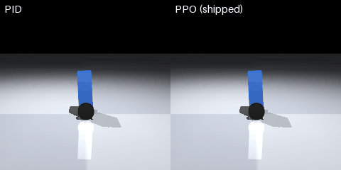
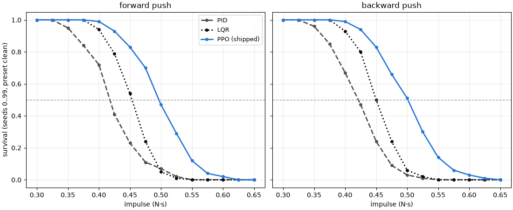
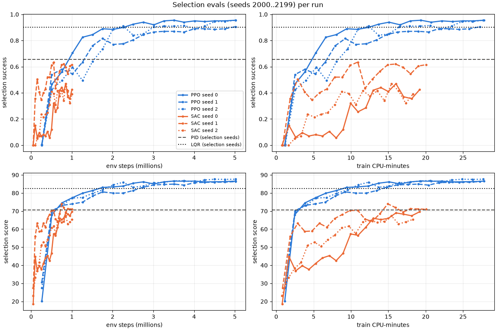
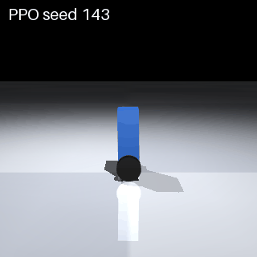
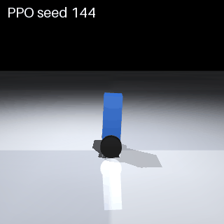
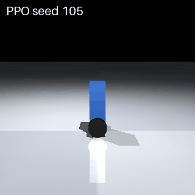

# Phase 2a results: learning to balance

Generated by `scripts/phase2_results.py` from `docs/results/phase2.json`; do not edit.

## 1. Hero: PID vs PPO



Seed chosen as the largest PPO−PID gap among eval_v1 seeds where PID fell; a median seed is below.

eval_v1 seed 1005: PID 29.66 (fell), PPO 88.80 (timeout), gap +59.14. [MP4 960x480 at 50 fps](phase2/hero.mp4); the GIF is 480 px wide at 20 fps.

- Median-difference seed, PID vs PPO: [eval_v1 seed 1015](phase2/median_pid_ppo.mp4), PPO − PID +10.55.
- Median-difference seed, LQR vs PPO: [eval_v1 seed 1008](phase2/median_lqr_ppo.mp4), PPO − LQR +3.32.

## 2. Scoreboard

3 of 3 PPO seeds reached the PID gate (G11: eligible, G2, G3 and G4 on 0..199); 2 of 3 at LQR level (G2b).

### eval_v1

| Controller | Score [95% CI] | Falls | Survival | Success | Median energy (J) | Mean saturation | Env steps (best) | Train CPU-min | PPO − PID [95% CI] | PPO − LQR [95% CI] |
|---|---|---|---|---|---|---|---|---|---|---|
| PID | 73.06 [63.77, 81.11] | 5 | 0.750 | 0.750 | 7.38 | 0.059 |  |  |  |  |
| LQR | 85.44 [79.87, 88.81] | 1 | 0.950 | 0.950 | 2.84 | 0.026 |  |  |  |  |
| PPO (shipped: best of 3 by selection seeds) | 90.93 [89.76, 92.06] | 0 | 1.000 | 1.000 | 2.48 | 0.024 | 5,013,504 | 27.7 | +17.86 [+10.52, +26.26] | +5.49 [+2.62, +10.38] |
| PPO recipe (3 seeds) | 87.95 ± 2.78 (min 85.42) |  |  | 0.950 ± 0.050 (min 0.900) |  |  |  |  |  |  |
| PPO seed 0 (ppo_s0) | 87.51 [81.92, 90.80] | 1 | 0.950 | 0.950 | 2.37 | 0.018 | 3,506,176 | 27.8 | +14.44 [+7.44, +22.76] | +2.07 [+1.42, +2.72] |
| PPO seed 1 (ppo_s1) | 85.42 [78.59, 89.61] | 1 | 0.950 | 0.900 | 3.65 | 0.024 | 1,753,088 | 27.3 | +12.36 [+5.93, +19.82] | -0.02 [-7.94, +7.28] |
| PPO seed 2 (ppo_s2) | 90.93 [89.76, 92.06] | 0 | 1.000 | 1.000 | 2.48 | 0.024 | 5,013,504 | 27.7 | +17.86 [+10.52, +26.26] | +5.49 [+2.62, +10.38] |
| SAC (1.0M steps, UTD 0.25) seed 0 (below PID gate) | 76.12 [67.73, 82.89] | 3 | 0.850 | 0.450 | 3.56 | 0.009 | 1,000,000 | 19.2 |  |  |
| SAC (1.0M steps, UTD 0.25) seed 1 (below PID gate) | 81.22 [72.75, 87.52] | 2 | 0.900 | 0.800 | 3.60 | 0.011 | 750,000 | 20.0 |  |  |
| SAC (1.0M steps, UTD 0.25) seed 2 (below PID gate) | 69.19 [58.60, 78.98] | 7 | 0.650 | 0.450 | 3.51 | 0.003 | 850,000 | 18.3 |  |  |

### Seeds 0..199 (Mac)

| Controller | Score [95% CI] | Falls | Survival | Success | Median energy (J) | Mean saturation | Env steps (best) | Train CPU-min | PPO − PID [95% CI] | PPO − LQR [95% CI] |
|---|---|---|---|---|---|---|---|---|---|---|
| PID | 68.72 [65.41, 71.96] | 71 | 0.645 | 0.645 | 6.49 | 0.074 |  |  |  |  |
| LQR | 80.08 [77.52, 82.46] | 27 | 0.865 | 0.865 | 3.26 | 0.046 |  |  |  |  |
| PPO (shipped: best of 3 by selection seeds) | 85.58 [83.43, 87.43] | 18 | 0.910 | 0.895 | 2.97 | 0.044 | 5,013,504 | 27.7 | +16.86 [+14.19, +19.66] | +5.50 [+4.01, +7.17] |
| PPO recipe (3 seeds) | 83.17 ± 3.78 (min 78.81) |  |  | 0.865 ± 0.084 (min 0.770) |  |  |  |  |  |  |
| PPO seed 0 (ppo_s0) | 85.11 [82.94, 86.99] | 14 | 0.930 | 0.930 | 2.61 | 0.027 | 3,506,176 | 27.8 | +16.39 [+13.63, +19.27] | +5.04 [+3.67, +6.56] |
| PPO seed 1 (ppo_s1) | 78.81 [75.84, 81.57] | 40 | 0.800 | 0.770 | 4.29 | 0.064 | 1,753,088 | 27.3 | +10.09 [+7.24, +12.99] | -1.26 [-3.55, +0.97] |
| PPO seed 2 (ppo_s2) | 85.58 [83.43, 87.43] | 18 | 0.910 | 0.895 | 2.97 | 0.044 | 5,013,504 | 27.7 | +16.86 [+14.19, +19.66] | +5.50 [+4.01, +7.17] |
| SAC (1.0M steps, UTD 0.25) seed 0 (below PID gate) | 69.14 [65.85, 72.33] | 69 | 0.655 | 0.410 | 3.65 | 0.010 | 1,000,000 | 19.2 |  |  |
| SAC (1.0M steps, UTD 0.25) seed 1 (below PID gate) | 72.71 [69.34, 75.94] | 57 | 0.715 | 0.665 | 3.68 | 0.017 | 750,000 | 20.0 |  |  |
| SAC (1.0M steps, UTD 0.25) seed 2 (below PID gate) | 65.64 [62.12, 69.12] | 84 | 0.580 | 0.495 | 3.68 | 0.010 | 850,000 | 18.3 |  |  |

Measured on darwin-arm64 arm64-sme, onnxruntime 1.31.0. CI's ubuntu numbers differ per episode (§3.5) and are shown in the second block, from `docs/results/phase2/ci_ubuntu/` (CI run 38891130614, policy 72b92aa744bf).

### Seeds 0..199 (ubuntu CI)

CI run 38891130614, policy 72b92aa744bf; linux-x86_64 avx2, onnxruntime 1.31.0.

| Controller | Score [95% CI] | Falls | Survival | Success | Median energy (J) | Mean saturation | Env steps (best) | Train CPU-min | PPO − PID [95% CI] | PPO − LQR [95% CI] |
|---|---|---|---|---|---|---|---|---|---|---|
| PID | 68.67 [65.35, 71.87] | 70 | 0.650 | 0.650 | 6.57 | 0.074 |  |  |  |  |
| LQR | 80.36 [77.83, 82.71] | 25 | 0.875 | 0.875 | 3.28 | 0.046 |  |  |  |  |
| PPO (shipped: best of 3 by selection seeds) | 85.55 [83.40, 87.40] | 18 | 0.910 | 0.890 | 2.93 | 0.044 | 5,013,504 | 27.7 | +16.88 [+14.21, +19.68] | +5.19 [+3.67, +6.88] |

## 3. Shove test

Preset `clean`, seeds 0..99, one push at 2.0 s (0.1 s pulse, no lateral part) of each impulse in 0.300..0.650 N·s, forward and backward. i50: where survival first falls through 50% (N·s).



| Controller | i50 forward | i50 backward | min |
|---|---|---|---|
| PID | 0.418 | 0.421 | 0.418 |
| LQR | 0.453 | 0.450 | 0.450 |
| PPO (shipped) | 0.497 | 0.501 | 0.497 |

## 4. Learning curves



CPU axis: train CPU-minutes: the run's process-tree cpu_s minus its selection evals' cpu_s, spread over env steps, plus the selection evals' cpu_s cumulated up to each eval.

- ppo_s0: env steps to PID level in [753,664, 1,015,808].
- ppo_s1: env steps to PID level in [1,261,568, 1,507,328].
- ppo_s2: env steps to PID level in [1,507,328, 1,753,088].

Wall-clock, on a shared machine (1-minute load at start and end): ppo_s0 9.0 min (load 4.8 to 9.0); ppo_s1 8.7 min (load 9.0 to 17.6); ppo_s2 8.8 min (load 17.2 to 13.1); sac_s0 11.4 min (load 13.1 to 14.6); sac_s1 11.7 min (load 14.2 to 9.5); sac_s2 10.9 min (load 9.5 to 6.1).

## 5. Failure gallery

The shipped PPO's 3 lowest-scoring seeds in 0..199.



Seed 143, score 13.30: fell at 1.66 s; last push 0.447 N·s at 1.14 s. GIF 320 px at 10 fps.



Seed 144, score 17.08: fell at 2.10 s; last push 0.394 N·s at 1.63 s. GIF 320 px at 10 fps.



Seed 105, score 21.28: fell at 2.75 s; last push 0.436 N·s at 1.83 s. GIF 320 px at 10 fps.

## 6. Reward-design notes

- u² kept: the energy-cost variant reached 64.9 / 0.505 with 82% of steps saturated (docs/design/phase-2.md §2.2 (pilot measurement)).
- log_std 0 beat −0.5 and −1 (docs/design/phase-2.md §2.2 (pilot measurement)).
- The action-excess penalty cut the share of steps with the pre-clip action mean outside ±1 from 21.9% to 10.1% at 1M steps (seed 1; ablate_nopenalty at step 1,015,808, ppo_s1 at step 1,015,808).
- The 1M-step failure mode without the penalty (ablate_nopenalty): selection success 0.190, score 67.63, median energy 54.76 J, mean saturation 0.262.
- With a constant learning rate, 1 of 3 seeds regressed after 2.3M steps (docs/design/phase-2.md §0 (pilot measurement)).

## 7. SAC vs PPO

SAC is "learner-throughput-limited (UTD 0.25, serial updates)". UTD 0.25 was chosen for the shared-machine budget (SAC's default UTD 1 measured 2.6 to 4.2x slower); target_entropy −4 and UTD 1 were tested and worse. Selection score / success from each run's logged evals:

| Pair | (a) equal env steps: SAC best | PPO | (b) equal CPU: PPO | (c) full budget: SAC best | SAC final − best | PPO best | PPO final − best |
|---|---|---|---|---|---|---|---|
| sac_s0 / ppo_s0 | 69.64 / 0.425 at 1,000,000 steps, 19.2 CPU-min | 77.45 / 0.705 at 1,015,808 steps, 5.3 CPU-min | 86.63 / 0.955 at 3,506,176 steps, 19.4 CPU-min | peak at 1,000,000 | +0.00 | 86.63 / 0.955 at 3,506,176 steps, 19.4 CPU-min | -0.05 |
| sac_s1 / ppo_s1 | 73.97 / 0.615 at 750,000 steps, 14.9 CPU-min | 73.12 / 0.580 at 753,664 steps, 3.8 CPU-min | 83.24 / 0.845 at 2,752,512 steps, 14.8 CPU-min | peak at 750,000 | -2.96 | 80.62 / 0.815 at 1,753,088 steps, 9.2 CPU-min | +5.69 |
| sac_s2 / ppo_s2 | 67.33 / 0.470 at 850,000 steps, 15.4 CPU-min | 73.24 / 0.495 at 753,664 steps, 4.0 CPU-min | 83.88 / 0.850 at 2,752,512 steps, 15.1 CPU-min | peak at 850,000 | -1.95 | 87.66 / 0.955 at 5,013,504 steps, 27.7 CPU-min | +0.00 |

## 8. README snippet

```markdown


| Controller | Score (seeds 0..199) | Success |
|---|---|---|
| PID | 68.72 | 0.645 |
| LQR | 80.08 | 0.865 |
| PPO (shipped) | 85.58 | 0.895 |
| SAC (mean of 3 seeds) | 69.16 | 0.523 |

PPO recipe over 3 seeds: mean score 83.17, min 78.81; mean success 0.865, min 0.770.
```
